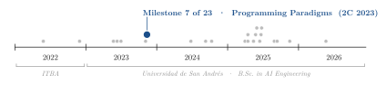
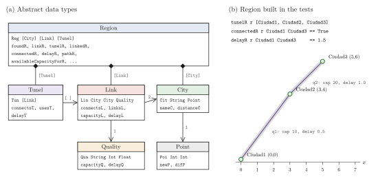
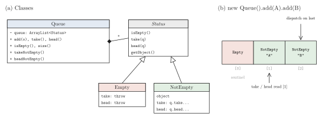
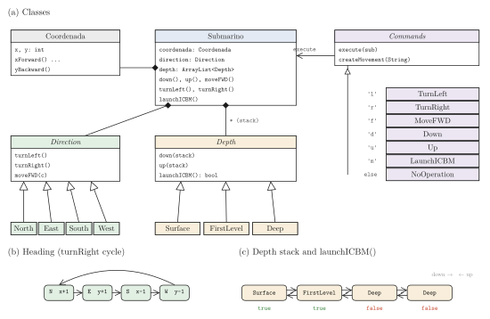
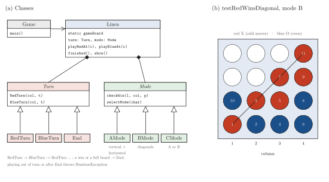

<div align="center">

# From Algebraic Data Types to Polymorphic Objects: Four Programming Paradigms Assignments

**Santiago Groba Alonso** · [Augusto Lanzini](https://github.com/Auguslann)

Universidad de San Andrés · *Programming Paradigms* · Second semester 2023 · Assignments 1–4

[](#reproducing-the-results)
[](#reproducing-the-results)
[](#reproducing-the-results)

<picture>
  <source media="(prefers-color-scheme: dark)" srcset="docs/figures/trajectory-dark.svg">
  
</picture>

</div>

> **Abstract.** This repository collects the four assignments of a Programming Paradigms course, written in pairs between August and November 2023. The first models a telecom network in Haskell as a set of opaque algebraic data types (points, cities, link qualities, links, tunnels and regions) manipulated only through pure functions. The other three are in Java and practise one idea from different angles: replacing conditionals with polymorphism. A FIFO queue is implemented without a single `if` by storing its empty/non-empty state as objects; a submarine delegates heading, depth and keyboard commands to small class hierarchies; and a Connect Four game uses state objects for turns and strategy objects for the three winning rules. All 43 Java tests (12 + 17 + 14) pass when re-run for this README; the 20 HUnit tests of the Haskell assignment could not be executed here because no GHC toolchain was available.

---

## 1. Problem

| # | Assignment | Language | What was asked |
|---|---|---|---|
| 1 | *Telco* | Haskell | Implement the modules `Point`, `City`, `Quality`, `Link`, `Tunel` and `Region` with the signatures given in the statement. Cities are added to a region, linked pairwise with a given quality (capacity and delay), and connected end to end by *tunnels* that consume one unit of capacity on every link they cross. |
| 2 | *Queue* | Java | Make the 12 given tests of a FIFO queue pass, without modifying them and with no `if` in the implementation. |
| 3 | *Submarine* | Java | A submarine with a position, a heading and a depth that obeys the commands `l r f d u m` (turn left, turn right, forward, down, up, launch missile); launching is only allowed at the surface or at the first submerged level. |
| 4 | *Connect Four* (*4 en línea*) | Java | A board of arbitrary base and height where red and blue alternate, with three winning modes: `A` (vertical or horizontal), `B` (diagonal) and `C` (either). |

The statements of assignments 1 and 2 are in the repository (`Tp1/enunciado`, `tp2/Consigna.txt`); assignments 3 and 4 are described here from their code and tests.

## 2. Methods

| Component | Choice |
|---|---|
| Haskell data types | One module per type, constructor hidden behind an export list (`newC`, `nameC`, ...); `Region` is rebuilt on every update (`foundR`, `linkR`, `tunelR` return a new region) |
| Tunnel creation | `tunelR` takes the ordered list of cities, looks up the link between each consecutive pair and refuses the tunnel when a link has no capacity left |
| Queue without `if` | The queue keeps a list of `Status` objects with an `Empty` sentinel at index 0; every request is dispatched to the last element, so an empty queue answers with its sentinel (which throws) and a non-empty one with a `NotEmpty` element |
| Submarine | `Direction` (North, East, South, West) answers `turnLeft`, `turnRight` and `moveFWD`; depths are a stack of `Depth` objects (Surface, FirstLevel, Deep) that decide `launchICBM()`; commands are `Commands` subclasses looked up from a `Map<String, Commands>` instead of a `switch` |
| Connect Four | `Turn` objects (`RedTurn`, `BlueTurn`, `End`) reject out-of-turn moves by throwing; `Mode` objects (`AMode`, `BMode`, `CMode`) implement the winning rule, with `CMode` composing the other two; win checks use `IntStream` pipelines instead of nested loops |
| Testing | HUnit for assignment 1, JUnit 5 for assignments 2–4 |

## 3. Results

### 3.1 Telco in Haskell

<p align="center"></p>

**Figure 1.** (a) The six abstract data types and what each constructor stores; arrows point from a type to the types it contains, with multiplicities. (b) The region built in `testdelayR` and `testusedCapacityForR` (`Tp1/Test.hs`): three cities, two links of different quality, and one tunnel (grey band) from `Ciudad1` to `Ciudad3`. The values on top are the ones those tests assert; the tunnel delay is the sum of the delays of its links.

### 3.2 A queue without conditionals

<p align="center"></p>

**Figure 2.** (a) `Queue` owns a list of `Status` objects; `Empty` and `NotEmpty` answer `take` and `head` differently. (b) Internal list after two `add` calls. `isEmpty`, `take` and `head` ask the *last* element, which is the `Empty` sentinel only when nothing else is stored; `takeNotEmpty` and `headNotEmpty` then read position 1, the oldest element, which gives FIFO order.

### 3.3 Submarine

<p align="center"></p>

**Figure 3.** (a) `Submarino` delegates to a `Direction`, a stack of `Depth` objects and a `Coordenada`; each command character maps to a `Commands` subclass, and unknown characters map to `NoOperation`. (b) `turnRight` cycles N → E → S → W → N; each heading moves the position by one unit along a different axis. (c) `down` pushes a level and `up` pops one (the surface cannot be left upwards); `launchICBM()` is `true` at the surface and at the first level and `false` below.

### 3.4 Connect Four

<p align="center"></p>

**Figure 4.** (a) `Linea` holds the board, the current `Turn` and the winning `Mode`; `Game` is the console driver. (b) The position reached by the moves of `testRedWinsDiagonal` on a 4 × 4 board in mode `B`; numbers give the move order, and move 11 completes red's diagonal and ends the game.

### 3.5 Test suites

**Table 1.** Test suites of each assignment. The Java suites were compiled and run for this README with JDK 25 and a minimal runner implementing the JUnit 5 annotations and assertions they use; the Haskell suite was not run because no GHC was installed in that environment.

| Assignment | Test file | Tests | Result |
|---|---|---:|---|
| 1. Telco | `Tp1/Test.hs` (HUnit) | 20 | not run here |
| 2. Queue | `tp2/queue/QueueTest.java` | 12 | 12 passed |
| 3. Submarine | `Tp3/src/submarino/SubTest.java` | 17 | 17 passed |
| 4. Connect Four | `Tp4/src/linea/LineaTest.java` | 14 | 14 passed |

## 4. Takeaways

- In Haskell the model *is* the set of types: once `Link`, `Tunel` and `Region` were defined, most functions reduced to a `filter`, `any` or `sum` over a list.
- Removing every `if` from the queue forced the state into objects. The empty case stopped being a check and became a class, and the same move (state objects, a command map instead of a `switch`) carried over to the submarine and to the turns of Connect Four.
- Keeping the Connect Four board in a `static` field made instances share state, so the tests have to clear it after each case (`@AfterEach`). A small, concrete lesson on global state.

## Reproducing the results

Haskell (assignment 1), as indicated at the top of `Tp1/Test.hs`:

```bash
cabal install --lib HUnit
cd Tp1 && runhaskell Test.hs
```

Java (assignments 2–4) with the JUnit 5 console launcher; the Eclipse and IntelliJ project files in `Tp3/`, `Tp4/` and `tp2/` also run the tests from the IDE.

```bash
JUNIT=junit-platform-console-standalone-1.10.2.jar
curl -LO https://repo1.maven.org/maven2/org/junit/platform/junit-platform-console-standalone/1.10.2/$JUNIT
javac -cp $JUNIT -d build/tp2 tp2/queue/*.java
javac -cp $JUNIT -d build/tp3 Tp3/src/submarino/*.java
javac -cp $JUNIT -d build/tp4 Tp4/src/linea/*.java
java -jar $JUNIT execute -cp build/tp2 --select-class queue.QueueTest
java -jar $JUNIT execute -cp build/tp3 --select-class submarino.SubTest
java -jar $JUNIT execute -cp build/tp4 --select-class linea.LineaTest
```

The diagrams are regenerated with `pip install matplotlib && python docs/figures/make_figures.py`.

| File | Content |
|---|---|
| `Tp1/enunciado` | Statement of assignment 1 (Spanish), with the required module signatures |
| `Tp1/*.hs` | `Point`, `City`, `Quality`, `Link`, `Tunel`, `Region` and the HUnit suite `Test.hs` |
| `tp2/Consigna.txt` | Statement of assignment 2 (Spanish) |
| `tp2/queue/` | `Queue`, `Status`, `Empty`, `NotEmpty` and the given `QueueTest` |
| `Tp3/src/submarino/` | Submarine, headings, depths, commands and `SubTest` |
| `Tp4/src/linea/` | `Linea`, turns, modes, the console driver `Game` and `LineaTest` |
| `docs/figures/` | Script and style used for the figures in this README |

## Acknowledgements

The statements of the assignments and the queue test suite were provided by the course teaching staff.

## Citation

```bibtex
@misc{groba2023paradigms,
  author       = {Groba Alonso, Santiago and Lanzini, Augusto},
  title        = {From Algebraic Data Types to Polymorphic Objects: Four Programming Paradigms Assignments},
  year         = {2023},
  howpublished = {Universidad de San Andr{\'e}s, Programming Paradigms},
  url          = {https://github.com/Santi2065/Tps-de-Paradigmas}
}
```
